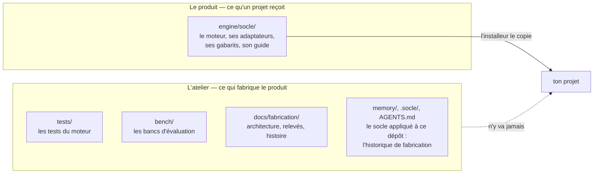
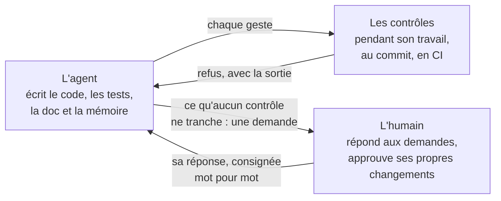

# Socle — mémoire, documentation et tests fiables pour agents de code

Version <!-- valeur:version -->0.1.0<!-- /valeur -->. Le socle s'installe
dans un projet de code qu'un agent entretient (Claude Code, ou un autre). Il
donne à l'agent une mémoire qui survit aux sessions et aux compactages, et
il rend ses erreurs détectables par une machine : une référence inventée, un
test qui ne mesure rien, une documentation qui dérive, un seuil relâché en
douce, une décision prise à la place de l'humain. L'agent écrit tout ; des
contrôles automatiques vérifient pendant son travail, au commit et en CI ;
l'humain ne tranche que ce qu'aucun contrôle ne peut trancher.

Un moteur Python 3.11+, bibliothèque standard seule, qui ne connaît ni le
langage du projet (un adaptateur le décrit) ni l'agent (ses hooks le
branchent).

## Ce dépôt : le produit et l'atelier



Seul **le produit**, `engine/socle/`, va dans un projet : l'installeur le
copie, puis pose une mémoire vide et les fichiers du projet. **L'atelier**
ne sort jamais d'ici : les tests, les bancs, la documentation de
fabrication, et la mémoire de ce dépôt. Le socle s'applique aussi à
lui-même, comme à n'importe quel projet : sa mémoire est l'historique de la
fabrication de l'outil (son backlog, son journal, ses décisions), pas un
modèle à recopier. Un projet équipé commence avec une mémoire vide.

## Comment ça marche



- **La mémoire** vit dans le dépôt, en six couches lisibles par script : les
  faits (chacun avec sa preuve), le chantier actif, les décisions, le
  journal, le backlog, et les demandes à l'humain. Elle s'écrit en ajout
  seul ; un identifiant se calcule, il ne se devine pas.
- **L'état du projet se calcule**, il ne s'écrit pas : au démarrage de
  chaque session et après chaque compactage, l'agent reçoit le commit, la
  CI, le backlog, ce qui attend l'humain, puis le chantier actif et les
  faits.
- **Une trentaine de contrôles** vérifient la mémoire, la documentation et
  les tests, à trois étages : les hooks de l'agent, les hooks git, la CI.
  La CI exécute tout, et rien ne la contourne.
- **Rien ne s'affaiblit en silence** : relâcher un seuil, supprimer un test,
  changer une valeur attendue ou toucher un fichier protégé exige la
  validation de l'humain.
- **Chaque garde-fou a été vu échouer** : l'auto-test injecte chaque défaut
  connu dans un projet jetable, et vérifie que l'étage prévu l'attrape.

Le détail, avec les schémas de ce que pose l'installation et du trajet
d'une demande : [le fonctionnement et les principes](docs/fonctionnement.md).

## Installer

Il faut Python 3.11 ou plus récent, et un dépôt git. Le moteur se récupère
seul, sans l'atelier : un clone partiel qui ne télécharge que
`engine/socle/` (environ 2 Mo), puis l'installeur.

```sh
git clone --depth 1 --filter=blob:none --sparse https://github.com/theodubus/memory /tmp/socle
git -C /tmp/socle sparse-checkout set engine
cd ton-projet
PYTHONPATH=/tmp/socle/engine python3 -m socle install --target . --owner @toi
```

L'adaptateur se déduit du dépôt ; `--adapter <nom>` le force. Adaptateurs
maintenus : `rust`, `python` (`unittest`), `python-pytest` (pytest et
mutmut), `javascript` (vitest et Stryker, TypeScript compris), `go` (go
test et gremlins), `java` (Maven, JUnit 5 et PIT), `ruby` (RSpec et
mutant), `php` (PHPUnit et Infection), `csharp` (dotnet test et
Stryker.NET). Un autre langage se décrit dans un fichier `.toml` passé à
`--adapter` ([les adaptateurs](engine/socle/adapters/README.md)).

Options utiles : `--with-bmad` installe aussi BMAD Method, qui planifie
pendant que le socle prouve et retient ; `--private compagnon` pose une
mémoire privée ; `--review lots` te fait relire ce qui part avant
publication ; `--language en` met la mémoire et les messages en anglais ;
`--adoption` équipe un projet existant dont des contrôles échouent encore.
Relancer la même commande met le socle à jour : le moteur est remplacé, et
le diff de ta politique t'est montré sans la toucher.

### Ce qu'un projet reçoit

```text
.socle/                   le lanceur, le moteur copié, sa politique, ses seuils, son adaptateur, ses hooks git
memory/                   une mémoire vide : faits, chantier actif, décisions, journal, backlog, demandes
AGENTS.md                 les instructions de l'agent (CLAUDE.md l'importe)
.claude/settings.json     les hooks de Claude Code
.github/workflows/        la CI, et le balayage de mutation hebdomadaire
.github/CODEOWNERS        toi, propriétaire de la politique, des hooks et de la CI
```

Rien de l'atelier : ni ses tests, ni ses bancs, ni sa mémoire.

### La première session

L'installation finit par « Et maintenant » : tes étapes, dans l'ordre,
chacune avec sa commande.

1. Décrire le projet à l'agent :
   `python3 .socle/socle init --brief <document> --repo`.
2. Commiter et pousser.
3. Ouvrir l'agent dans le projet : il lit l'état au démarrage et te pose
   les questions de départ dans la conversation.
4. Protéger la branche par défaut : y exiger la CI « Socle — verify,
   contrôles, auto-test » ; sans cela, une CI rouge n'empêche pas de
   fusionner.

Ensuite, `python3 .socle/socle help` donne tes gestes, chacun avec sa
commande : répondre aux demandes de l'agent, approuver tes propres
changements protégés, relire avant publication si tu l'as choisi. Ce guide
est aussi [dans le dépôt](engine/socle/HELP.md).

## Lire la suite

Le produit :

- [le fonctionnement et les principes](docs/fonctionnement.md) — la
  mémoire, les contrôles, les trois étages, la politique, les demandes, et
  que faire quand un contrôle refuse ;
- [le guide de l'humain](engine/socle/HELP.md) — tes gestes, chacun avec sa
  commande ;
- [le format de la mémoire](engine/socle/FORMAT.md) — ce qui fait foi pour
  la lire et l'écrire ;
- [les adaptateurs](engine/socle/adapters/README.md) — comment un langage
  se décrit.

L'atelier :

- [la fabrication](docs/fabrication/README.md) — l'architecture, les bancs,
  les relevés, et l'histoire du socle ;
- [comment travailler dans ce dépôt](AGENTS.md) ;
- [le cadrage fondateur](memory/archives/cadrage-2026-10-10.md), tel quel.
