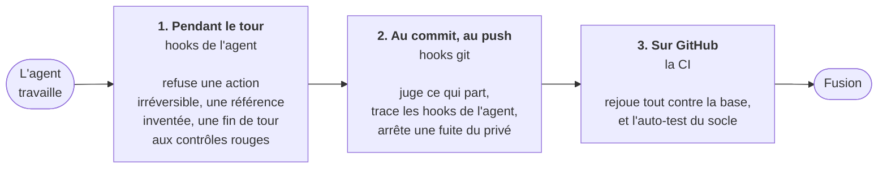
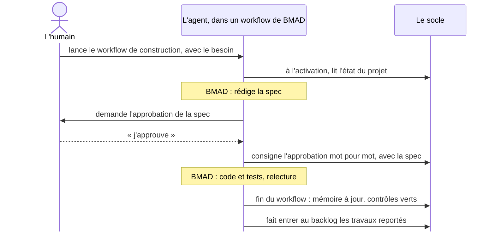

# Socle

**Mémoire et garde-fous pour les agents de code qui entretiennent un projet
dans la durée.**

Le socle s'installe dans un dépôt de code qu'un agent (Claude Code, ou un
autre) fait évoluer de session en session. Il conserve la mémoire du projet
dans le dépôt, la restitue à l'agent à chaque démarrage, et vérifie
automatiquement ce que l'agent produit : code, tests, documentation et
mémoire. L'humain n'a plus à tout relire ; il ne tranche que les décisions
qu'aucun contrôle ne peut prendre à sa place.

Ce document présente le socle : le problème qu'il traite, son principe de
fonctionnement, seul ou avec BMAD Method, sa structure et son installation.
L'utilisation au quotidien d'un projet équipé est décrite dans
[le guide d'utilisation](engine/socle/HELP.md).

## Le problème

Un agent de code travaille par sessions, et chaque session repart de zéro.
Sur un projet de plusieurs semaines, cette discontinuité produit des
erreurs récurrentes :

- **l'oubli** : une décision prise, une consigne donnée, un écueil déjà
  rencontré disparaissent d'une session à l'autre ;
- **la dérive** : les notes de l'agent et la documentation qu'il tient
  cessent progressivement de décrire le code ;
- **les tests sans portée** : une assertion qui compare une valeur à
  elle-même, un test désactivé, une valeur attendue modifiée pour que le
  test passe ;
- **les références inventées** : un fichier, un commit ou un identifiant
  cités alors qu'ils n'existent pas ;
- **l'affaiblissement** : un seuil relâché pour faire passer un contrôle,
  une question tranchée à la place de l'humain.

Chacune de ces erreurs est plausible et silencieuse : elle n'apparaît
qu'après coup, quand elle apparaît.

## Le principe de fonctionnement

Le socle ne suppose pas l'agent fiable : il rend ses erreurs détectables
par une machine, le plus tôt possible. L'agent écrit tout ; des contrôles
automatiques vérifient ; l'humain arbitre ce qui ne se vérifie pas.

### La mémoire du projet

La mémoire vit dans le dossier `memory/` du dépôt, versionnée avec le code,
dans un format qu'un script sait lire. Elle compte cinq couches et la file
des demandes, chacune avec sa règle :

| Couche | Contenu | Règle |
| --- | --- | --- |
| Faits | ce qui est établi | chaque fait porte un statut (mesuré, supposé, réfuté, validé) et sa preuve |
| Chantier actif | le travail en cours et les étapes suivantes | seul fichier réécrit librement, de taille bornée |
| Décisions | une décision par fichier, avec ses raisons | seul son statut change ensuite |
| Journal | une entrée datée par événement | ajout seul |
| Backlog | les sujets à traiter, un par fichier | chaque sujet a une origine ; un sujet clos cite ce qui l'a clos |
| Demandes | les décisions qui attendent l'humain, puis sa réponse | une demande répondue est gelée |

Chaque entrée a un identifiant stable (`F-NNNN` pour un fait, `ADR-NNNN`
pour une décision, `J-AAAA-MM-JJ-X` pour une entrée de journal…), calculé
par une commande et jamais deviné. Une entrée citée avec son empreinte
(`ADR-NNNN@xxxxxxxx`) prouve qu'elle a été lue dans sa version actuelle.

Ce qui se calcule ne s'écrit pas : au démarrage de chaque session et après
chaque compactage de la conversation, l'agent reçoit l'état du projet,
dérivé de git et de la mémoire (commit, CI, backlog, ce qui attend
l'humain), puis le chantier actif et les faits.

Deux options complètent la mémoire. Une **zone privée** reçoit ce qui ne
doit pas être public (un client, une idée), dans un dépôt compagnon privé
ou en fichiers chiffrés ; les contrôles vérifient que rien n'en fuit dans ce
qui se publie. La mémoire s'écrit **en français ou en anglais**, au choix
du projet. Le format exact est spécifié dans
[le format de la mémoire](engine/socle/FORMAT.md).

### Trois étages de contrôle

Une trentaine de contrôles s'exécutent à trois moments. Chaque étage arrête
l'agent un peu plus tard que le précédent : une erreur attrapée pendant le
tour ne coûte presque rien, et la CI rattrape tout ce qui aurait échappé aux
deux premiers.



| Étage | Quand | Ce qu'il fait |
| --- | --- | --- |
| L'agent (hooks de Claude Code) | au démarrage, avant chaque outil, à la fin de chaque tour | injecte l'état ; refuse une action irréversible, l'écriture d'un fichier protégé, une réponse à la place de l'humain, une référence ou un SHA inventés, une fuite du privé ; refuse de conclure tant que les contrôles échouent, que la mémoire est en retard sur le code, ou que le dernier message ne dit pas ce qui revient à l'humain |
| git | à chaque commit et à chaque push | juge ce qui sera commité avec les contrôles rapides ; trace dans le commit les hooks de l'agent qui ont tiré ; refuse une fuite du privé ; avant le push, juge la plage qui part comme la CI la jugera |
| La CI | à chaque push et pull request | exécute tout, contre la base : les outils du langage, tous les contrôles, et l'auto-test du socle |

Les contrôles portent sur quatre domaines :

- **la mémoire** : tout identifiant, fichier, lien ou commit cité existe ;
  chaque fait a sa preuve ; le journal et les décisions sont en ajout seul ;
  la mémoire suit le code qui change ;
- **la documentation** : une valeur citée est liée à sa source et concorde ;
  le code associé à un document ne change pas sans lui ; un même paragraphe
  dans deux fichiers est refusé ;
- **les tests** : pas de test sans assertion ni d'assertion tautologique ;
  une valeur attendue ne change pas, un test ne disparaît pas, sans
  validation humaine ; une fonction publique ajoutée est nommée par un
  test ; un correctif apporte un test qui échoue sur le commit précédent ;
  chaque module a un plafond de mutants survivants, mesuré par un balayage
  hebdomadaire ;
- **ce qui ne doit pas s'affaiblir** : les seuils, les fichiers protégés,
  l'empreinte du moteur, la trace des hooks dans chaque commit de l'agent.

Avec un autre agent que Claude Code, le premier étage manque ; les hooks
git et la CI s'appliquent de la même façon.

### Les décisions réservées à l'humain

Une politique d'autonomie, modifiée par l'humain seul, fixe ce que l'agent
décide et ce qu'il demande. L'agent décide seul ce qui est réversible et
mesurable, et le consigne. Il demande ce qui est coûteux à défaire,
irréversible ou externe (publier, pousser sur la branche par défaut), et
tout ce qui affaiblirait un garde-fou : relâcher un seuil, supprimer un
test, changer une valeur attendue.

La question prend la forme d'une **demande**, rédigée pour être lue sans le
contexte de la session : la décision, le contexte résumé, les éléments cités
décrits en clair, des liens vers ce qu'il faut lire, les options avec leur
effort, leur risque et leur réversibilité, une recommandation, et les
réponses possibles. Un contrôle refuse une demande incomplète. L'humain
répond dans la conversation ; l'agent consigne la réponse avec son texte
exact, et la demande est gelée. Une question tranchée sur le moment,
l'humain présent, se consigne de la même façon, en décision prise en
séance.

### Ce qui ne s'affaiblit pas

Chaque seuil (budgets de taille, plafonds de mutation, correspondances
entre code et documentation) est sous cliquet : le durcir est libre, le
relâcher exige une demande validée qui le nomme. Les fichiers protégés (la
politique, l'adaptateur, les hooks, la CI, les réponses de l'humain) ne
changent qu'avec une validation qui cite leur empreinte nouvelle.

Chaque garde-fou a été vu échouer : l'auto-test injecte chaque défaut
connu dans un projet jetable et vérifie que l'étage prévu l'attrape ; la CI
l'exécute à chaque push.

### Une session, de bout en bout


Sur un projet jetable, une référence inventée dans la mémoire et une valeur
attendue modifiée produisent, telles quelles, ces deux refus :

```text
  memoire.references                 ECHEC
      | memory/active.md:14 — `F-0003` ne désigne aucune entrée de la mémoire
  tests.attendus                     ECHEC
      | tests/test_calc.py:6 — assertion changée ou retirée dans `test_double` : « self.assertEqual(double(2), 4) » — valeur attendue modifiée sans spécification ni validation humaine
```

L'agent ne peut pas terminer son tour dans cet état : il corrige la
référence, et pour le test, rétablit la valeur ou pose la question.

## Avec BMAD Method

[BMAD Method](https://github.com/bmad-code-org/BMAD-METHOD) est une méthode
de développement assisté par agents : des workflows et des rôles (analyste,
chef de produit, architecte, développeur) qui conduisent un projet du brief
au code, en passant par le PRD, l'architecture, les epics, les stories et
les specs. BMAD organise le travail ; il ne vérifie pas ce que l'agent
produit, et sa mémoire s'arrête à ses documents.

Les deux outils sont complémentaires, et le socle les marie sans modifier
aucun fichier de BMAD : chaque nature d'information a un seul propriétaire.

| BMAD Method planifie | Le socle prouve et retient |
| --- | --- |
| brief, PRD, architecture et ses décisions, epics, stories, specs, état du sprint, actions de rétrospective | faits prouvés, consignes, décisions hors de l'architecture, journal, backlog des trouvailles, ce qui revient à l'humain |

Ce que le mariage apporte :

- **le socle lit BMAD sans le recopier** : l'état du démarrage montre les
  specs non terminées, les stories en cours ou en revue et les actions
  ouvertes ; les décisions d'architecture de BMAD se citent avec leur
  empreinte, comme celles du socle ;
- **les workflows de BMAD portent la mémoire et la fin de tour du socle**,
  par la personnalisation officielle de BMAD que l'installeur pose : à
  l'activation, l'état du projet ; à la fin, la mémoire tenue à jour et les
  contrôles verts ;
- **une seule façon de consulter l'humain** : quand un workflow de BMAD
  demande l'approbation d'une spec, la réponse est consignée mot pour mot
  dans le registre des demandes ; une spec approuvée ne quitte pas le
  brouillon sans cette approbation, et son intention figée ne change plus
  sans une approbation nouvelle ;
- **une seule liste des trouvailles** : un travail que BMAD reporte entre au
  backlog du socle par une commande, et un contrôle refuse un report resté
  dehors ;
- **les contrôles s'appliquent aux documents de BMAD** comme au reste du
  projet ; ses propres fichiers (skills, scripts) sont déclarés tiers et
  échappent aux contrôles.

Le déroulé d'un workflow de construction de BMAD, dans un projet équipé
des deux :



Un projet équipé des deux se lit donc ainsi : BMAD dit ce qu'il faut
construire et dans quel ordre, le socle garantit que ce qui est construit
est vérifié et que ce qui a été appris est conservé. Une session réelle,
mesurée de bout en bout, a mené le workflow de construction de BMAD jusqu'au
commit : la spec a été approuvée en séance, l'approbation consignée avant le
code, l'intention figée laissée intacte, et aucun contrôle n'a refusé.

Une option de l'installeur installe les deux (voir plus bas) ; leur usage
conjoint est décrit dans [le guide d'utilisation](engine/socle/HELP.md).

## Structure

### Ce que l'installation ajoute à un projet

```text
.socle/
  socle               le lanceur : python3 .socle/socle <commande>
  engine/socle/       le moteur, copié tel quel ; la CI vérifie son empreinte
  engine.lock         sa version et son empreinte
  policy.toml         la politique d'autonomie
  guardrails.toml     les seuils des contrôles, sous cliquet
  adapter.toml        le langage du projet et ses outils
  git-hooks/          les hooks git, branchés par core.hooksPath
memory/               la mémoire du projet, vide à l'installation
AGENTS.md             les instructions de l'agent ; CLAUDE.md l'importe
.claude/settings.json les hooks de Claude Code
.github/workflows/    la CI, et le balayage de mutation hebdomadaire
.github/CODEOWNERS    l'humain, propriétaire de la politique, des hooks et de la CI
```

Trois sortes de fichiers : le moteur, que seul l'installeur remplace ; les
fichiers du projet (mémoire, seuils), que l'agent modifie selon la
politique ; les étages d'application (politique, hooks, CI), protégés.
L'installeur ne remplace jamais un fichier que le projet a déjà écrit.

Le moteur est en Python 3.11 ou plus récent, sans dépendance, et ne connaît
ni le langage du projet ni l'agent : ce qui dépend du langage est décrit
par un adaptateur, ce qui dépend de l'agent passe par ses hooks.

### Ce dépôt

| Partie | Où | Rôle |
| --- | --- | --- |
| Le produit | `engine/socle/` | le moteur, ses adaptateurs, ses gabarits, son guide : la seule partie copiée dans un projet |
| L'atelier | `tests/`, `bench/`, `docs/fabrication/` | ce qui fabrique et éprouve le produit ; rien n'en est copié |
| Le socle appliqué à ce dépôt | `memory/`, `.socle/`, `AGENTS.md` | ce dépôt est lui-même équipé du socle ; sa mémoire est l'historique de la fabrication, pas un modèle |

## Installation

### Prérequis

- Python 3.11 ou plus récent, et git.
- Un projet dans un langage maintenu : Rust, Python (sous `unittest` ou
  pytest), JavaScript et TypeScript, Go, Java, Ruby, PHP ou C#. Un autre
  langage se décrit par un adaptateur
  ([la spécification des adaptateurs](engine/socle/adapters/README.md)).
- Pour les trois étages : Claude Code et un dépôt sur GitHub.
- Avec BMAD Method : Node.js 20.12 ou plus récent (pour `npx`) et `uv`.

### Commandes

Le moteur se récupère seul, par un clone partiel qui ne télécharge que
`engine/socle/` (environ 2 Mo) :

```sh
git clone --depth 1 --filter=blob:none --sparse https://github.com/theodubus/memory /tmp/socle
git -C /tmp/socle sparse-checkout set engine
cd <projet>
PYTHONPATH=/tmp/socle/engine python3 -m socle install --target . --owner @<propriétaire>
```

`--owner` désigne le propriétaire des fichiers protégés dans `CODEOWNERS`.
Le langage se déduit du dépôt.

| Option | Effet |
| --- | --- |
| `--with-bmad` | installe d'abord BMAD Method, à la version éprouvée avec le socle, puis le socle, qui le reconnaît ; `--bmad-version` en choisit une autre |
| `--adapter <nom>` | impose l'adaptateur (`rust`, `python`, `python-pytest`, `javascript`, `go`, `java`, `ruby`, `php`, `csharp`, ou le chemin d'un fichier `.toml`) |
| `--adoption` | équipe un projet existant dont des contrôles échouent : ils passent en avertissement, et ne peuvent ensuite que durcir |
| `--private compagnon` ou `--private chiffre` | ajoute une mémoire privée ; le mode compagnon, un dépôt privé à part, est le plus sûr |
| `--review lots` ou `--review chaque-push` | exige la relecture de l'humain avant toute publication vers le dépôt public |
| `--language en` | mémoire, gabarits et messages du moteur en anglais |

### Après l'installation

L'installeur termine par la liste des étapes suivantes, chacune avec sa
commande : décrire le projet à l'agent (`socle init`), commiter et pousser,
ouvrir l'agent dans le projet, puis protéger la branche par défaut sur
GitHub pour y exiger la CI du socle. La suite relève du
[guide d'utilisation](engine/socle/HELP.md), copié dans le projet et
affiché par `python3 .socle/socle help`.

## État du projet

Version <!-- valeur:version -->0.1.0<!-- /valeur -->, en développement. Le
socle est éprouvé sur des projets jetables dans chacun des langages
maintenus, y compris sur la CI de GitHub ; sur une copie d'un projet réel
de plusieurs semaines ; et par un banc qui fait travailler un agent réel sur
des scénarios propices aux erreurs. Il n'équipe pas encore de projet en
production.

Limites connues : l'étage de l'agent n'existe que pour Claude Code ; le
mode chiffré de la mémoire privée dépend d'un filtre que le socle ne pose
pas (git-crypt ou équivalent) ; l'installation passe encore par un clone,
faute de paquet publié.

## Documentation

| Document | Portée |
| --- | --- |
| Ce README | ce qu'est le socle, son principe, sa structure, son installation |
| [Le guide d'utilisation](engine/socle/HELP.md) | l'usage d'un projet équipé : le rôle de l'humain, chaque geste avec sa commande, les refus, la référence des commandes et de la politique |
| [Le format de la mémoire](engine/socle/FORMAT.md) | la spécification de la mémoire, pour l'agent et les outils |
| [La spécification des adaptateurs](engine/socle/adapters/README.md) | comment décrire un langage |

La fabrication du socle (architecture interne, bancs, relevés, histoire)
est documentée à part, dans [l'atelier](docs/fabrication/README.md).
