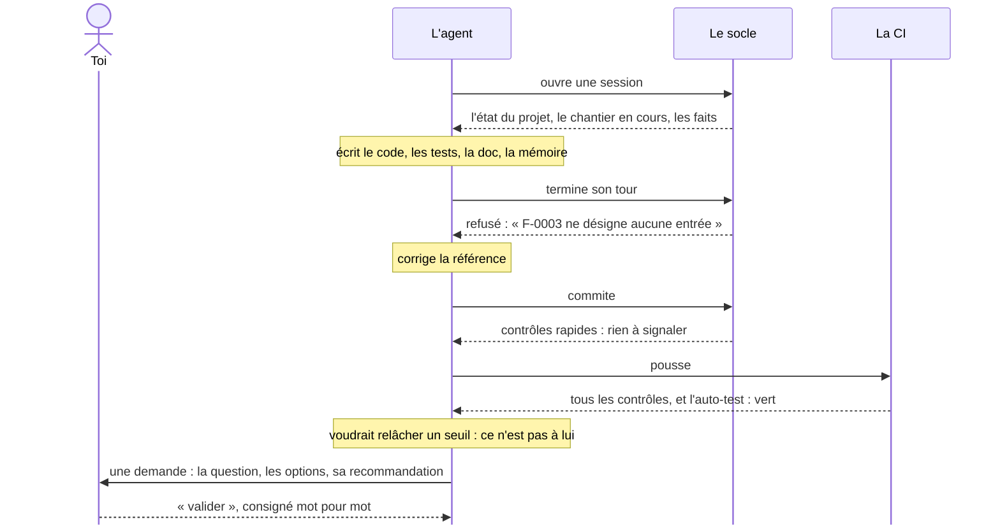

# Socle

**Une mémoire et des garde-fous pour les agents de code qui entretiennent
un projet dans la durée.**

Le socle s'ajoute à un projet de code qu'un agent (Claude Code, ou un autre)
fait avancer de session en session. Il garde la mémoire du projet dans le
dépôt, la remet à l'agent à chaque démarrage, et vérifie automatiquement ce
que l'agent écrit : son code, ses tests, sa documentation, sa mémoire.
L'humain n'a plus à relire chaque détail ; il ne tranche que ce qu'aucune
machine ne peut trancher.

## Le problème

Un agent de code est rapide, mais il travaille par sessions, et chacune
repart de zéro. Sur un projet de plusieurs semaines, cela se paie :

- **il oublie** : une décision prise mardi, une consigne donnée la veille,
  un piège déjà rencontré ;
- **ses notes dérivent** : ce qu'il écrit pour s'en souvenir, et la
  documentation qu'il tient, cessent peu à peu de dire vrai ;
- **ses tests peuvent ne rien prouver** : une assertion qui compare une
  valeur à elle-même, un test désactivé, une valeur attendue changée pour
  que le test passe ;
- **il invente** : un fichier, un commit, un identifiant qui n'existent pas,
  cités avec aplomb ;
- **il assouplit** : un seuil relâché pour faire passer un contrôle, une
  question tranchée à la place de l'humain.

Chacune de ces erreurs est plausible et silencieuse. On la découvre tard,
quand on la découvre.

## Ce que fait le socle

Il ne demande pas à l'agent d'être fiable : il rend ses erreurs visibles
pour une machine, au plus tôt.

**Une mémoire qui survit aux sessions.** Les faits établis (chacun avec sa
preuve), le chantier en cours, les décisions, le journal, le backlog :
dans le dépôt, versionnés, dans un format qu'un script sait lire. À chaque
démarrage et après chaque compactage, l'agent reçoit l'état du projet
calculé depuis git (le commit, la CI, ce qui attend l'humain), puis le
chantier et les faits.

**Des contrôles à trois moments.** Pendant le travail de l'agent, à chaque
commit, et en CI, une trentaine de contrôles vérifient que chaque fichier,
commit ou identifiant cité existe, que la documentation suit le code qu'elle
décrit, qu'un test affirme vraiment quelque chose, qu'un correctif apporte
le test qui l'aurait attrapé. La CI rejoue tout, et rien ne la contourne.

**Les vraies décisions te reviennent, une à une.** Relâcher un seuil,
supprimer un test, faire une action irréversible : l'agent ne le fait pas
seul. Il t'écrit une demande qui se lit sans le contexte en tête : la
question, les options, ce qu'il recommande et pourquoi. Tu réponds dans la
conversation ; ta réponse est consignée mot pour mot.

**Rien ne s'affaiblit en silence.** Chaque seuil est sous cliquet : le
durcir est libre, le relâcher exige ta validation. Chaque garde-fou a été vu
échouer : l'auto-test injecte chaque défaut connu dans un projet jetable et
vérifie qu'il est attrapé.

## À quoi ça ressemble

Une session ordinaire, du point de vue de l'agent :



Ce que l'agent reçoit au démarrage, sur un projet qui vient d'être équipé
(extrait, sorti tel quel) :

```text
== demo — état dérivé par `socle state`, rien de recopié ==
commit   : 859b89a sur main (arbre propre)
mémoire  : 0 fait(s) (aucun) · 0 décision(s) · journal : 1 entrée(s), dernière J-2026-10-20-A
backlog  : 0 ouvert(s), 0 en cours, 0 bloqué(s), 0 clos
demandes humaines en attente : 0
ce qui revient à l'humain : rien
…
--- memory/active.md ---
```

Ce qu'il voit quand il cite une entrée qui n'existe pas, et change la valeur
attendue d'un test pour qu'il passe :

```text
  memoire.references                 ECHEC
      | memory/active.md:14 — `F-0003` ne désigne aucune entrée de la mémoire
  tests.attendus                     ECHEC
      | tests/test_calc.py:6 — assertion changée ou retirée dans `test_double` : « self.assertEqual(double(2), 4) » — valeur attendue modifiée sans spécification ni validation humaine
```

L'agent ne peut pas finir son tour ainsi : il corrige la référence, et pour
le test, soit il remet la valeur, soit il te pose la question.

## Ce qu'il faut

- Python 3.11 ou plus récent, et git. Le moteur n'a aucune dépendance.
- Un projet dans l'un des langages maintenus : Rust, Python (`unittest` ou
  pytest), JavaScript et TypeScript, Go, Java, Ruby, PHP, C#. Un autre
  langage se décrit dans un fichier de configuration
  ([les adaptateurs](engine/socle/adapters/README.md)).
- Pour les trois étages : Claude Code pour les contrôles pendant le travail,
  GitHub pour la CI. Avec un autre agent, ou une autre forge, les hooks git
  et la commande de CI fonctionnent ; l'étage de l'agent manque.
- Facultatif : BMAD Method, qui planifie pendant que le socle prouve et
  retient ; une seule option installe les deux.

## Essayer

Le moteur se récupère seul, sans le reste de ce dépôt :

```sh
git clone --depth 1 --filter=blob:none --sparse https://github.com/theodubus/memory /tmp/socle
git -C /tmp/socle sparse-checkout set engine
cd ton-projet
PYTHONPATH=/tmp/socle/engine python3 -m socle install --target . --owner @toi
```

L'installeur détecte le langage, pose le socle et finit par tes étapes
suivantes, chacune avec sa commande : décrire le projet à l'agent, commiter,
ouvrir l'agent, protéger la branche par défaut. Ensuite,
`python3 .socle/socle help` te donne tes gestes au quotidien. Les options
(mémoire privée, relecture avant publication, mémoire en anglais, projet
existant) sont dans [le guide de l'humain](engine/socle/HELP.md).

## Documentation

| Tu veux… | Lis |
| --- | --- |
| comprendre comment le socle fonctionne, et pourquoi | [le fonctionnement et les principes](docs/fonctionnement.md) |
| savoir quoi faire au quotidien : répondre à l'agent, approuver, mettre à jour | [le guide de l'humain](engine/socle/HELP.md) |
| savoir comment la mémoire est écrite | [le format de la mémoire](engine/socle/FORMAT.md) |
| brancher un autre langage | [les adaptateurs](engine/socle/adapters/README.md) |
| contribuer au socle, ou savoir comment il a été fait | [la fabrication](docs/fabrication/README.md) |

## Où en est le projet

Version <!-- valeur:version -->0.1.0<!-- /valeur -->, en développement. Le
socle est éprouvé sur des projets jetables dans chacun des langages
maintenus, sur la CI de GitHub, par un banc qui fait travailler un agent
réel sur des scénarios propices aux fautes, et sur une copie d'un vrai
projet de plusieurs semaines. Il n'équipe pas encore de projet en
production : c'est la prochaine étape.

## Ce dépôt

| Partie | Où | Ce que c'est |
| --- | --- | --- |
| **Le produit** | `engine/socle/` | le moteur, ses adaptateurs, ses gabarits, son guide : la seule chose que l'installation copie dans un projet |
| **L'atelier** | `tests/`, `bench/`, `docs/fabrication/` | ce qui fabrique et éprouve le produit ; rien n'en sort |
| **Le socle appliqué à lui-même** | `memory/`, `.socle/`, `AGENTS.md` | ce dépôt est équipé du socle comme n'importe quel projet ; sa mémoire est l'historique de la fabrication, pas un modèle |
